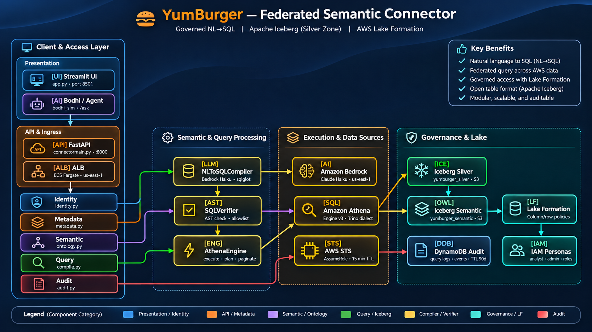
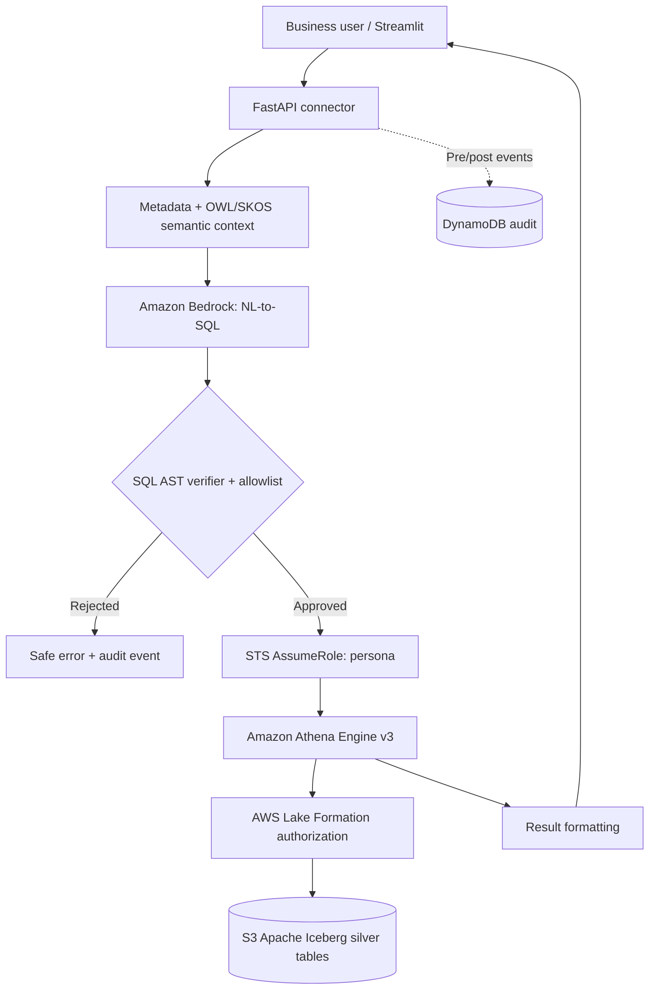
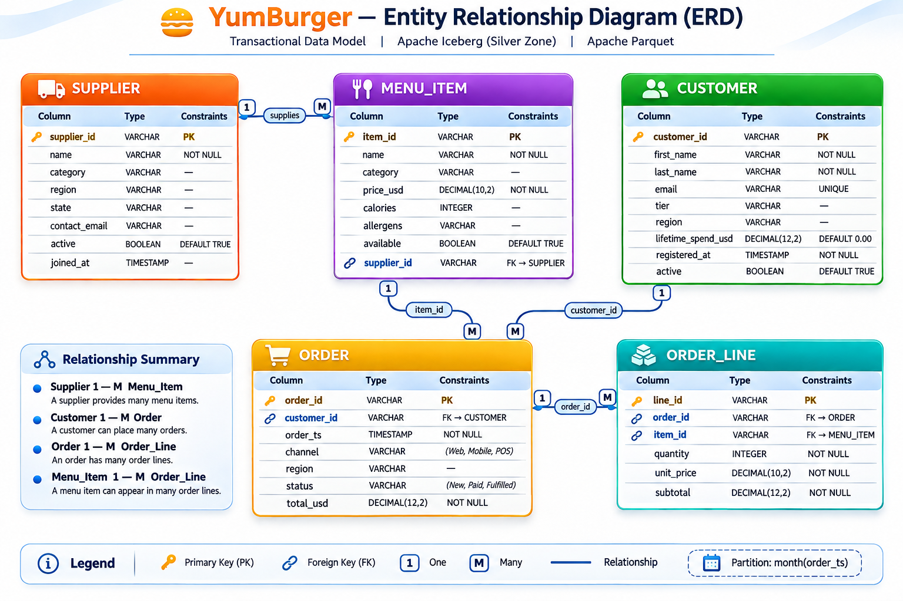

<div align="center">
  

# YumBurger Analytics

**Governed Natural Language-to-SQL · Federated Semantic Connector · AWS Lakehouse**


*Ask business questions in plain English. Execute only validated SQL against a governed lakehouse.*

[Overview](#overview) · [Architecture](#architecture) · [Data Model](#data-model) · [Getting Started](#getting-started) · [API](#api-reference) · [Security](#security-and-governance) · [Testing](#testing-and-validation)

</div>

---

## Overview

YumBurger Analytics is an AWS-based proof of concept for a restaurant-chain analytics platform. It demonstrates how analysts can ask business questions without writing SQL while the platform translates those questions into validated Athena queries over Apache Iceberg tables in Amazon S3.

**Example questions:**

- Who are our top five customers by revenue?
- What is total revenue by region?
- Which menu items contain gluten?
- How many suppliers are active?

The solution combines Amazon Bedrock, Amazon Athena, AWS Lake Formation, AWS STS, Apache Iceberg, FastAPI, and Streamlit. It includes synthetic data generation, semantic ontology mappings, persona-based access, query auditing, infrastructure as code, and automated tests.

> **Core security invariant:** LLM-generated SQL is never sent directly to Athena. Queries must first pass SQL AST validation and table allowlist checks; Athena and Lake Formation then enforce the permissions of the assumed persona role.

### Capabilities at a glance

| Capability | Implementation |
|---|---|
| Natural-language analytics | Amazon Bedrock LLM generates SQL from questions and semantic context |
| Governed query execution | SQLGlot AST validation, SELECT-only policy, table allowlist |
| Fine-grained authorization | STS persona roles and Lake Formation column/row controls |
| Open lakehouse | Apache Iceberg v2 and Parquet in S3, queried through Athena Engine v3 |
| Business semantics | OWL/SKOS ontology and 74 natural-language term mappings |
| Traceability | DynamoDB pre/post execution audit events; hashed questions and 90-day TTL |
| User interfaces | Streamlit dashboard and FastAPI REST endpoints |
| Deployment | Docker, ECS Fargate, ALB, and AWS CDK v2 |

---

## Architecture

<div align="center">
  
</div>

### End-to-end query lifecycle



> The diagram summarizes logical responsibilities. In AWS, Athena uses the catalog and applicable Lake Formation permissions to access registered tables; Lake Formation is not a separate SQL execution engine.

### Five connector planes

| Plane | Source module | Responsibility |
|---|---|---|
| Identity | `connector/identity.py` | Assume persona-scoped IAM roles using STS; 15-minute session duration |
| Metadata | `connector/metadata.py` | Retrieve table schema information using Athena `DESCRIBE` |
| Semantic | `connector/ontology.py` | Resolve business vocabulary through OWL/SKOS mappings |
| Query | `connector/compiler.py`, `connector/engines/athena.py` | Compile, validate, execute, poll, and paginate queries |
| Audit | `connector/audit.py` | Record pre- and post-execution events in DynamoDB |

### AWS service responsibilities

| Service | Purpose |
|---|---|
| Amazon Bedrock | Foundation model for NL-to-SQL generation |
| Amazon Athena | Engine v3 SQL execution over Iceberg tables |
| Amazon S3 + Apache Iceberg | Silver and semantic data storage |
| AWS Lake Formation | Governed table, column, and row access |
| AWS STS + IAM | Temporary persona credentials and scoped access |
| Amazon DynamoDB | Query audit events |
| Amazon ECS Fargate + ALB | Container hosting and application ingress |
| Amazon CloudWatch | Dashboards and alarms provisioned by the observability stack |

---

## Data Model

<div align="center">
  
</div>

### Silver zone: `yumburger_silver`

| Table | Seed rows | Purpose |
|---|---|---|
| `supplier` | 50 | Ingredient and goods suppliers |
| `menu_item` | 30 | Menu catalog, prices, allergens, supplier association |
| `customer` | 500 | Loyalty customers and lifetime spending |
| `order` | 2,000 | Customer transactions; partitioned by `month(order_ts)` |
| `order_line` | 5,048 | Line items connecting orders and menu items |
| **Total** | **7,628** | Synthetic demonstration records |

Relationships: Supplier 1→many Menu Item; Customer 1→many Order; Order 1→many Order Line; Menu Item 1→many Order Line. The Iceberg data model uses logical foreign-key relationships; Athena does not enforce relational foreign-key constraints.

### Semantic zone: `yumburger_semantic`

| Table | Seed rows | Purpose |
|---|---|---|
| `ontology_class` | 7 | OWL classes associated with silver tables |
| `ontology_property` | 12 | OWL properties associated with columns |
| `ontology_mapping` | 74 | Natural-language terms mapped to schema hints |

---

## Getting Started

### Prerequisites

- Python 3.11+
- AWS account and configured AWS CLI credentials
- Docker Desktop or a compatible Docker runtime
- Node.js/npm and AWS CDK v2
- Permissions to deploy AWS infrastructure and access the selected Bedrock model

### Local setup and deployment

```bash
# Clone the repository
git clone https://github.com/tmbothe/yumburger.git
cd yumburger

# Install the Python project
pip install -e .

# Configure runtime settings
cp .env.example .env
# Edit .env, including BEDROCK_MODEL_ID

# Deploy AWS resources
cd infra
cdk deploy --all
cd ..

# Seed the lakehouse and publish semantic mappings
make datagen
make load
make ontology-publish

# Start FastAPI
make serve

# In a separate terminal, start Streamlit
python -m streamlit run app.py
```

Local defaults: FastAPI on port `8000`; Streamlit on port `8501`. The deployment creates AWS resources that can incur charges.

### Example `.env`

```dotenv
BEDROCK_MODEL_ID=us.anthropic.claude-haiku-4-5-20251001-v1:0
AWS_REGION=us-east-1
AWS_PROFILE=default
CONNECTOR_HOST=0.0.0.0
CONNECTOR_PORT=8000
LOG_LEVEL=INFO
```

> Confirm model availability, model access, and region compatibility in your AWS account before deploying.

---

## API Reference

The API exposes natural-language analytics, schema discovery, ontology metadata, and operational health endpoints.

### `POST /ask` — business-language answer

Returns a natural-language answer alongside execution metadata and the compiled SQL.

**Request**

```json
{
  "question": "What are the top 5 most expensive menu items?",
  "persona": "analyst",
  "max_rows": 20
}
```

**Illustrative response**

```json
{
  "request_id": "a3f7c2b1-...",
  "answer": "The top 5 most expensive items are ...",
  "compiled_sql": "SELECT name, price_usd FROM menu_item ORDER BY price_usd DESC LIMIT 5",
  "row_count": 5,
  "duration_ms": 4820
}
```

> Response content and latency above are examples, not live measurements.

### `POST /query` — structured query results

Returns compiled SQL and row data for consumers such as the Streamlit interface. SQL generation remains subject to the same validation and authorization controls.

### Additional endpoints

| Method | Path | Purpose |
|---|---|---|
| `GET` | `/health` | Service health |
| `GET` | `/tables` | Available tables |
| `GET` | `/metadata/{table}` | Table schema |
| `GET` | `/snapshots/{table}` | Iceberg snapshot history |
| `GET` | `/ontology/classes` | Semantic classes |
| `GET` | `/ontology/properties` | Semantic properties |
| `GET` | `/docs` | OpenAPI / Swagger UI |

### Local API example

```bash
curl -X POST http://localhost:8000/ask \
  -H 'Content-Type: application/json' \
  -d '{"question":"Who are the top 5 customers by revenue?","persona":"analyst"}'
```

---

## Security and Governance

The design uses defense in depth:

1. **Prompt-level guidance** — instructs the LLM not to generate data-changing statements; advisory only.
2. **SQL validation** — SQLGlot AST parsing, SELECT-only restrictions, and table allowlist checks before execution.
3. **Persona-scoped identity** — STS `AssumeRole` creates short-lived credentials for the selected role.
4. **Data authorization** — Lake Formation controls permitted columns and rows when Athena accesses registered data.
5. **Auditability** — DynamoDB records pre/post events with hashed questions and a 90-day TTL configuration.

The connector runtime role carries an explicit `s3:GetObject` deny on the silver data path, intended to prevent direct application reads. Validate this policy against Athena result access, Lake Formation registration, service roles, and all relevant resource policies in the deployed environment.

**Production hardening checklist:**

- Enforce HTTPS and authentication on all public endpoints
- Derive personas from authenticated identities rather than trusting a client-provided `persona` field
- Use private networking where practical
- Enforce Athena workgroup limits, timeouts, result-size limits, and S3 encryption
- Validate verifier bypass resistance
- Monitor errors and spend
- Review retention and access to audit records (DynamoDB TTL alone does not make records tamper-evident)

---

## Infrastructure as Code

Eight AWS CDK v2 stacks:

| Stack | Provisioned responsibilities |
|---|---|
| `StorageStack` | Silver, semantic, Athena results, and audit-log S3 buckets |
| `IAMStack` | Connector runtime and analyst/admin persona roles |
| `LakeFormationStack` | Lake Formation registrations and permissions |
| `AthenaStack` | Query workgroup and result configuration |
| `DynamoDBStack` | Audit table and TTL |
| `ObservabilityStack` | CloudWatch dashboards and alarms |
| `BudgetStack` | $50/month budget alert |
| `ServiceStack` | ECR, ECS cluster, Fargate services, and ALB |

```bash
cd infra
cdk deploy --all

# Example: deploy the service stack only
cdk deploy ServiceStack
```

---

## Testing and Validation

The project includes 65 tests spanning unit, security, and golden-question coverage.

```bash
# Full test suite
pytest

# Unit and security tests (no AWS required)
pytest tests/unit tests/security

# Live golden-question tests (requires deployed connector)
pytest tests/golden -m live
```

### Representative golden questions

| ID | Business question |
|---|---|
| G001 | How many active suppliers do we have? |
| G002 | What are the top 5 most expensive menu items? |
| G005 | What is total revenue by region? |
| G008 | Show the top 10 customers by lifetime spend |
| G010 | Which menu items contain gluten? |

For a production evaluation, add explicit checks for unauthorized column access, prompt injection, non-SELECT statements, incorrect joins, query-cost ceilings, retries, and audit completeness.

---

## Repository Layout

```text
yumburger/
├── connector/
│   ├── main.py                 # FastAPI routes and startup
│   ├── compiler.py             # NL-to-SQL compilation and verification
│   ├── identity.py             # STS persona role assumption
│   ├── metadata.py             # Athena schema metadata
│   ├── ontology.py             # Semantic ontology integration
│   ├── audit.py                # DynamoDB audit events
│   ├── engines/athena.py       # Athena query execution
│   ├── models.py               # Request/response models
│   └── settings.py             # Runtime configuration
├── infra/stacks/               # Eight AWS CDK stacks
├── lakehouse/                  # Iceberg DDL and loading
├── ontology/                   # OWL/SKOS definitions and publishing
├── datagen/                    # Synthetic data generator
├── bodhi_sim/                  # Agent simulator
├── tests/                      # Unit, security, golden tests
├── assets/                     # Logo and architecture/ERD images
├── app.py                      # Streamlit dashboard
├── Dockerfile                  # API container
└── Dockerfile.streamlit        # UI container
```

## Developer Commands

| Command | Action |
|---|---|
| `make setup` | Install dependencies and bootstrap CDK |
| `make lint` | Ruff lint/format checks |
| `make test` | Run pytest suite |
| `make datagen` | Generate sample data |
| `make deploy` | Deploy CDK stacks |
| `make load` | Load Iceberg tables |
| `make ontology-publish` | Validate and publish ontology |
| `make serve` | Run FastAPI connector |
| `make golden` | Run golden-question tests |
| `make destroy` | Tear down provisioned AWS resources |

---

## Technology Stack

| Layer | Technology |
|---|---|
| Language | Python 3.11 |
| API / UI | FastAPI, Uvicorn, Streamlit 1.59 |
| Lakehouse | Apache Iceberg v2, Parquet, S3 |
| SQL engine | Amazon Athena Engine v3 (Trino dialect) |
| AI | Amazon Bedrock / Claude Haiku |
| SQL safety | SQLGlot |
| Semantic modeling | OWL/SKOS, RDFLib |
| Configuration | Pydantic Settings v2 |
| Infrastructure | AWS CDK v2 (Python), Docker, ECS Fargate |
| Testing | pytest, moto |
| Code quality | Ruff |

---

## Cost Considerations

Rough POC estimates for `us-east-1`:

| Component | Estimate / month |
|---|---|
| ECS Fargate (API and UI) | $10–15 |
| Athena | $1–2 |
| Bedrock Claude Haiku | $1–3 |
| ALB, ECR, DynamoDB, S3 | $2 |
| **Range** | **$14–22** |

These are not validated AWS quotes and may understate ECS/ALB, networking, logging, and data-transfer costs. Use the [AWS Pricing Calculator](https://calculator.aws/) with your actual configuration to forecast spend. The `$50/month` AWS Budget alert does not cap spending.

---

## Scope and Next Steps

This is a proof of concept / reference implementation, not a claim of audited production readiness. Priorities for a production rollout include verified HTTPS ingress and authentication, robust identity-to-persona mapping, automated policy tests, deployment validation, query observability, and realistic load/cost testing.

## License

MIT — see [LICENSE](LICENSE).

---

<div align="center"><sub>YumBurger Analytics · Governed AI analytics on AWS · 2026</sub></div>
