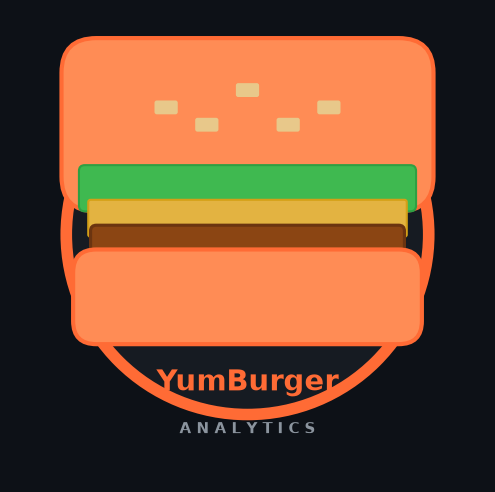

# YumBurger — Architecture & Business Plan



## Business Overview

YumBurger is a fast-food restaurant chain operating the same product catalog and
business model as McDonald's: burgers, fries, beverages, desserts, and combo meals
sold through physical locations and drive-throughs.

**Problem**: Operations teams ask natural-language questions about sales, suppliers,
menu performance, and customer behavior. Answers are locked in raw S3 data with no
governed, audited query path.

**Solution**: A Federated Semantic Connector that lets authorized personas ask
questions in plain English, compiles those questions to safe SQL, and returns
governed answers from an Apache Iceberg silver zone — with full audit trails.

---

## Architecture

```
                        +------------------+
     User / Bodhi       |  FastAPI/MCP     |  connector/
     (NL Question) ---> |  Connector       |
                        +--------+---------+
                                 |
              +------------------+------------------+
              |                  |                  |
       Identity Plane    Semantic Plane       Metadata Plane
       (identity.py)    (ontology.py)        (metadata.py)
       STS AssumeRole   Athena SELECT        Athena DESCRIBE
              |          yumburger_semantic   yumburger_silver
              |                  |                  |
              +------------------+------------------+
                                 |
                          Query Plane
                          (compiler.py)
                          NL -> SQL (Bedrock)
                          verifier check
                                 |
                          engines/athena.py
                          Athena SQL execution
                          as persona IAM role
                                 |
                    +------------+------------+
                    |                         |
            Lake Formation             Apache Iceberg
            column/row policies        on S3 (silver zone)
            enforced at Athena         yumburger_silver.*
                                       (Athena-only access)
                                 |
                          Audit Plane
                          (audit.py)
                          DynamoDB PutItem
                          connector-runtime role
```

### Key Design Decisions
1. **Iceberg on S3 is the single source of truth** — never copied
2. **Athena is the only access layer** — no direct S3 access from connector
3. **Lake Formation enforces governance** — column masking + row filters
4. **LLM SQL is NEVER executed** — only compiler-verified, parameterized SQL
5. **All audit events** go to DynamoDB before query execution

---

## Data Model (Silver Zone)

### Tables in `yumburger_silver`

| Table | Description | Key Columns |
|-------|-------------|-------------|
| `supplier` | Ingredient suppliers | supplier_id, name, category, region |
| `menu_item` | Menu products | item_id, name, category, price_usd, calories |
| `customer` | Loyalty customers | customer_id, tier, region, signup_date |
| `order` | Order headers | order_id, customer_id, location_id, order_ts |
| `order_line` | Line items per order | line_id, order_id, item_id, qty, unit_price |

All tables are Apache Iceberg format, stored in S3, queried only via Athena.

---

## Ontology Model (`yumburger_semantic`)

Classes: `MenuItem`, `Supplier`, `Customer`, `Order`, `Location`, `Ingredient`
Properties: `hasPrice`, `hasCalories`, `suppliedBy`, `placedBy`, `containsItem`
Row-level policies: Analyst sees only their region; Admin sees all

---

## IAM Roles

| Role | Purpose | Key Permissions |
|------|---------|-----------------|
| `yumBurger-connector-runtime` | Connector service role | Athena, DynamoDB, Bedrock; Deny s3:GetObject silver/* |
| `yumBurger-persona-analyst` | Analyst queries | Athena SELECT on analyst-visible columns |
| `yumBurger-persona-admin` | Admin queries | Athena SELECT on all columns |

---

## Infrastructure (7 CDK Stacks)

1. **StorageStack** — S3 buckets: `raw`, `silver`, `semantic`, `athena-results`, `audit`
2. **IAMStack** — IAM roles for connector + personas
3. **LakeFormationStack** — LF databases, table permissions, column/row policies
4. **AthenaStack** — Workgroup `yumBurger-wg`, result location, query engine v3
5. **DynamoDBStack** — `yumBurger-audit` table (pk: request_id, sk: ts)
6. **ObservabilityStack** — CloudWatch dashboard, Athena cost alarms
7. **BudgetStack** — AWS Budgets $50/month alert to owner email

---

## Cost Model (Small Scale, POC)

| Service | Estimated Monthly Cost |
|---------|----------------------|
| S3 storage (< 1 GB) | < $0.05 |
| Athena queries (< 100 queries @ ~10 MB scanned) | < $0.05 |
| Redshift Serverless (paused when idle) | < $5.00 |
| Bedrock (Claude Sonnet, < 100 NL queries) | < $2.00 |
| DynamoDB (on-demand, < 1K writes) | < $0.50 |
| CloudWatch | < $1.00 |
| **Total** | **< $10/month** |

Budget alert fires at $50/month.

---

## Implementation Phases

| Phase | Deliverable | Verify |
|-------|-------------|--------|
| 1 | Foundation: pyproject, Makefile, config | `make setup` |
| 2 | Data generation: Parquet files | `make datagen` |
| 3 | Infrastructure: 7 CDK stacks | `make deploy && make verify-infra` |
| 4 | Lakehouse: Iceberg tables loaded | `make load && make dq` |
| 5 | Ontology: published to semantic zone | `make ontology-publish` |
| 6 | Connector: FastAPI + all planes | `make serve` |
| 7 | Tests + Bodhi sim | `make test && make golden` |
| 8 | Demo + Runbook | `make demo` |
